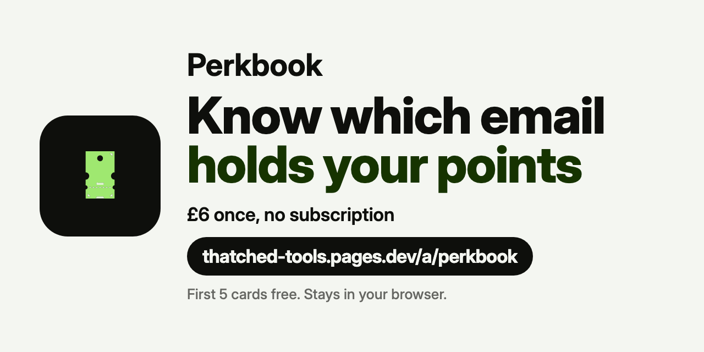

# Perkbook

**Loyalty cards on too many emails?** Perkbook is one web page for all your loyalty and rewards cards, each listed with the email or phone you signed up with.

**Try it: https://thatched-tools.pages.dev/go/perkbook/readme**

## What it does
- Know which email holds your points: the **By email / phone** view groups every programme under the inbox or number it is on.
- Keep member number, points, points expiry date, login page and notes next to each card.
- You type it in yourself: Perkbook never logs in to any account and does not look anything up.
- Your list stays in your browser.

## How to use
1. Open the page and enter your email to start.
2. Add a programme and the email or phone it is registered with, or load the sample data in one click.
3. Switch to **By email / phone** to see each inbox and the cards on it.

## Free and paid
- Free: your first 5 programmes, CSV export, JSON backup and import.
- Full version: £6, paid once, no subscription. Adds unlimited programmes, a password-locked backup file and .ics expiry reminders a month before.

## Status
Working, checked in Chrome. Other browsers not all checked yet.

## Help
Questions or ideas: open an issue in this repo.

## About this repo
This repo holds the README and banner only; no code is published here. Perkbook runs at the link above.
